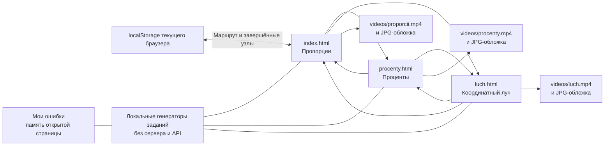
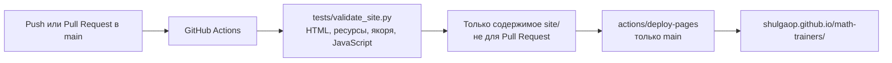
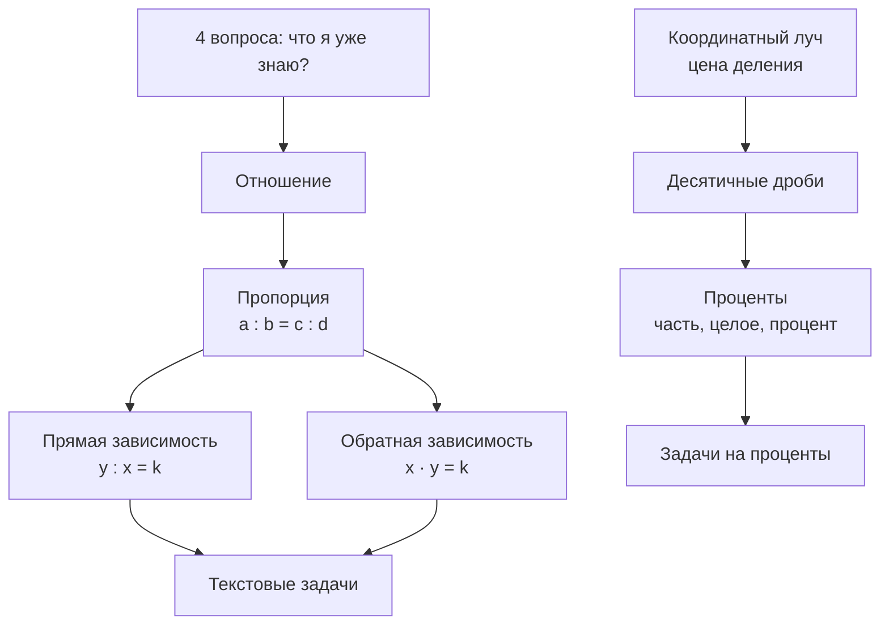

# Графы проекта

Файл показывает фактические связи между страницами, ресурсами, проверками и публикацией. При изменении архитектуры графы обновляются вместе с `CONTEXT.md`. GitHub отображает диаграммы Mermaid без дополнительных библиотек в самом проекте.

## Архитектура сайта

Все три страницы содержат собственные HTML, CSS и JavaScript. Счёт тренажёров и список «Мои ошибки» хранятся только в памяти открытой страницы; в `localStorage` сохраняется только учебный маршрут пропорций. Ответы ученика наружу не отправляются.

## Проверка и публикация

Публикация запускается только после успешной проверки. Адрес на схеме подтверждён успешным workflow #2 и открытием публичного сайта.

## Учебный граф

На главной странице раздел «С чего начать» помогает выбрать тему, прочитать объяснение, проверить ответ и перейти к заданиям. Схема показывает связи тем, но не ограничивает свободный переход между уроками через перекрёстные ссылки.
